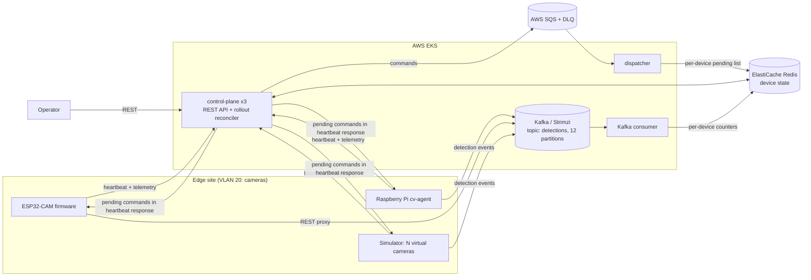

# EdgeFleet — IoT Camera Fleet Manager

A control plane for managing a fleet of edge cameras: remote configuration, staged firmware rollouts with automatic rollback, per-device health, and a Kafka pipeline for detection events.

| Component | Language | Path |
|---|---|---|
| Control plane (REST API, rollout engine, command dispatcher, Kafka consumer) | Go | `cmd/control-plane`, `internal/` |
| Fleet simulator (N virtual cameras) and Kafka load generator | Go | `cmd/simulator`, `cmd/loadgen` |
| ESP32-CAM firmware (OTA with A/B rollback, motion detection) | C / ESP-IDF 5 | `firmware/esp32-cam` |
| Raspberry Pi CV agent (OpenCV MOG2 + HOG person detection) | Python | `cv-agent` |
| Pi node networking (802.1Q VLANs, iptables default-deny) | Bash / systemd | `deploy/rpi` |
| AWS infrastructure (VPC, EKS, ElastiCache Redis, SQS + DLQ, ECR, S3, IRSA) | Terraform | `infra/terraform` |
| Kubernetes manifests (control plane, Strimzi Kafka, load-test jobs) | YAML / Kustomize | `deploy/k8s` |

See [docs/SCOPE.md](docs/SCOPE.md) for scope, milestones and success metrics.

## Architecture



**Command path.** An operator calls the API → the control plane writes desired state to Redis and enqueues a command to SQS → dispatcher workers long-poll SQS and push each command onto the device's pending list in Redis, acking only after the write → the device gets its commands in the response to its next heartbeat. Delivery is at-least-once, so devices dedupe on `command.id`. Messages that can't be processed go to a dead-letter queue after 5 receives, with a CloudWatch alarm.

**Staged rollouts.** `POST /v1/rollouts` orders a group's devices healthy-first and releases them in cumulative stages (default 5% → 25% → 100%). The reconciler promotes a stage only when every device in it reports the target version and the stage has soaked for `soak_seconds`. If the failure rate exceeds `max_failure_rate` at any point, every device touched so far gets a `rollback_firmware` command. On the ESP32, a new image boots in `PENDING_VERIFY` and is only marked valid after its first successful heartbeat. If it never gets there, the bootloader reverts to the other OTA slot by itself.

**Health.** Each heartbeat carries CPU, free memory, temperature, FPS, RSSI, error count and uptime. `GET /v1/devices/{id}/health` and `GET /v1/groups/{group}/health` report `healthy` / `degraded` / `offline` and the reasons.

**Logging.** All Go services emit JSON logs (`log/slog`) with `request_id`, `route`, `device_id` and `duration_ms`. Heartbeat logs are at debug level so log volume scales with operator activity, not fleet size. The CV agent also logs JSON. `/metrics` exposes Prometheus counters and gauges.

## REST API

Operator routes require `Authorization: Bearer $OPERATOR_TOKEN` (when set). Device routes use `$DEVICE_TOKEN`.

| Method | Path | Purpose |
|---|---|---|
| POST | `/v1/devices` | Register a device `{id, kind, group, firmware_version}` |
| GET | `/v1/devices?group=&health=&limit=` | List / filter devices |
| GET / DELETE | `/v1/devices/{id}` | Get / remove a device |
| PUT | `/v1/devices/{id}/group` | Move a device to a group |
| PATCH | `/v1/devices/{id}/config` | Push config to one device |
| GET | `/v1/devices/{id}/health` | Per-device health check |
| POST | `/v1/devices/{id}/rollback` | Roll one device back to its previous firmware |
| POST | `/v1/devices/{id}/reboot` | Reboot a device |
| GET | `/v1/groups` | Groups and device counts |
| PATCH | `/v1/groups/{group}/config` | Push config to every device in a group |
| GET | `/v1/groups/{group}/health` | Health summary + unhealthy devices |
| POST | `/v1/rollouts` | Start a staged rollout `{group, target_version, firmware_url, stages, max_failure_rate, soak_seconds}` |
| GET | `/v1/rollouts`, `/v1/rollouts/{id}` | Rollout status |
| POST | `/v1/rollouts/{id}/pause` · `/resume` · `/rollback` | Operator control |
| POST | `/v1/agent/{id}/heartbeat` | Device telemetry in, pending commands out |
| GET | `/healthz`, `/readyz`, `/metrics` | Liveness, readiness (pings Redis), Prometheus |

## Quick start

```bash
# In-memory control plane + 500 simulated cameras (only needs Go)
make run            # terminal 1
make sim            # terminal 2

curl localhost:8080/v1/groups
curl -X PATCH localhost:8080/v1/groups/parking/config -d '{"fps":"10"}'
curl -X POST localhost:8080/v1/rollouts -d '{"group":"lobby","target_version":"1.1.0","firmware_url":"http://fw/1.1.0.bin","stages":[5,25,100],"soak_seconds":10}'
```

To see an automatic rollback, run the simulator with `-bad-version 2.0.0` and roll `2.0.0` out to a group.

Full stack (Redis, LocalStack SQS, Kafka, control plane, simulator):

```bash
docker compose up --build
make loadtest       # 10k events/sec target for 2 minutes
```

### Deploy to AWS

```bash
cd infra/terraform && terraform init && terraform apply
$(terraform output -raw kubeconfig_command)
kubectl create namespace kafka && kubectl apply -n kafka -f 'https://strimzi.io/install/0.44.0?namespace=kafka'
kubectl apply -f deploy/k8s/kafka/kafka.yaml
# fill deploy/k8s/base/configmap.yaml + serviceaccount.yaml from `terraform output`, push images to ECR
kubectl apply -k deploy/k8s/base
kubectl apply -f deploy/k8s/loadtest/simulator.yaml
kubectl apply -f deploy/k8s/loadtest/loadgen-job.yaml && kubectl logs -n edgefleet -l job-name=loadgen -f
terraform destroy   # EKS + NAT + ElastiCache cost roughly $0.40/hr; tear down after testing
```

## Load testing

`cmd/loadgen` publishes `DetectionEvent`s keyed by `device_id` to the `detections` topic at a target rate and prints achieved events/sec and p50/p99 produce latency as JSON. On EKS the job runs 4 pods × 3,000 events/sec against a 3-broker Strimzi cluster (m6i.large nodes, 12 partitions, RF=3, `min.insync.replicas=2`).

| Scenario | Target | Measured |
|---|---|---|
| Simulated fleet | 500 cameras, 2 s heartbeats (~250 req/s) | 500 cameras, all healthy, 0 heartbeat errors (local, in-memory) |
| Staged rollout, 125 devices, 1% random flash failures | completes | completed 5 → 25 → 100%, 4/125 failed (under the 10% gate) |
| Bad firmware rollout | auto-rollback at canary | rolled back at the 10% stage; 0 devices left on the bad version |
| Kafka detection throughput (EKS) | 10,000 events/sec sustained | _run `loadgen-job.yaml` and record here_ |

## Tests

```bash
make test   # go vet + go test -race, pytest for cv-agent, host-compiled firmware motion tests
```

CI (`.github/workflows/ci.yml`) also runs `idf.py build` for the firmware, `terraform validate`, and Docker builds.
